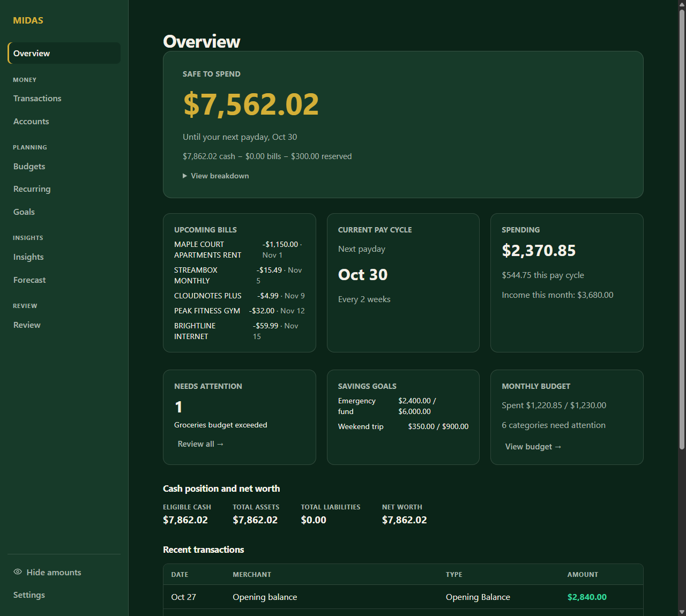
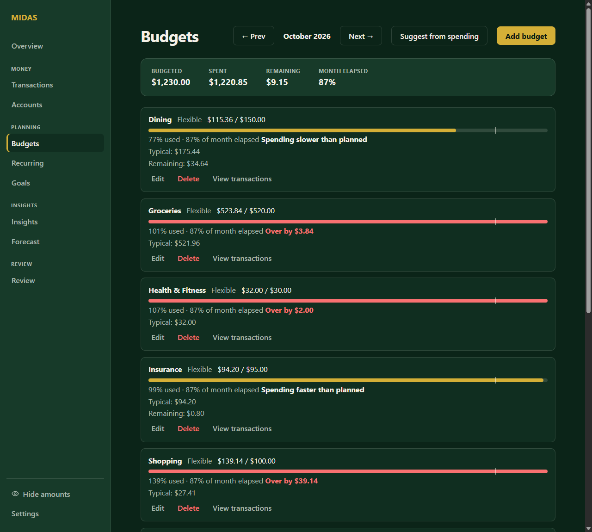
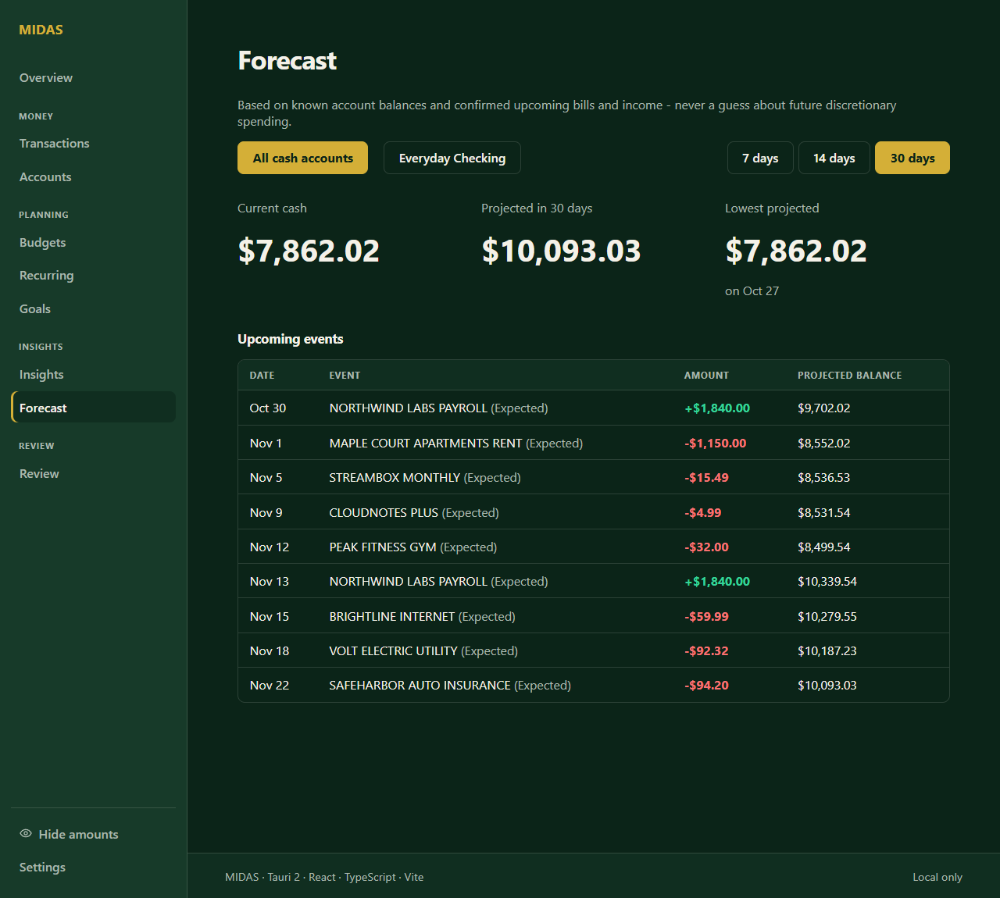
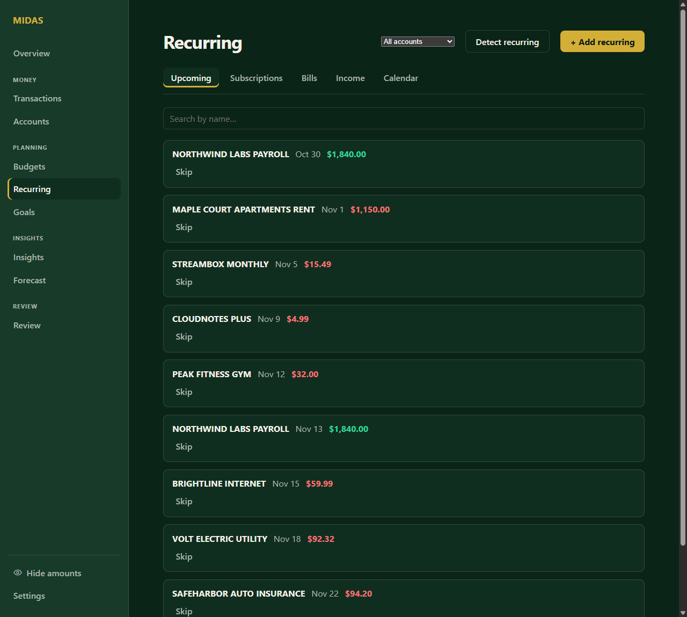
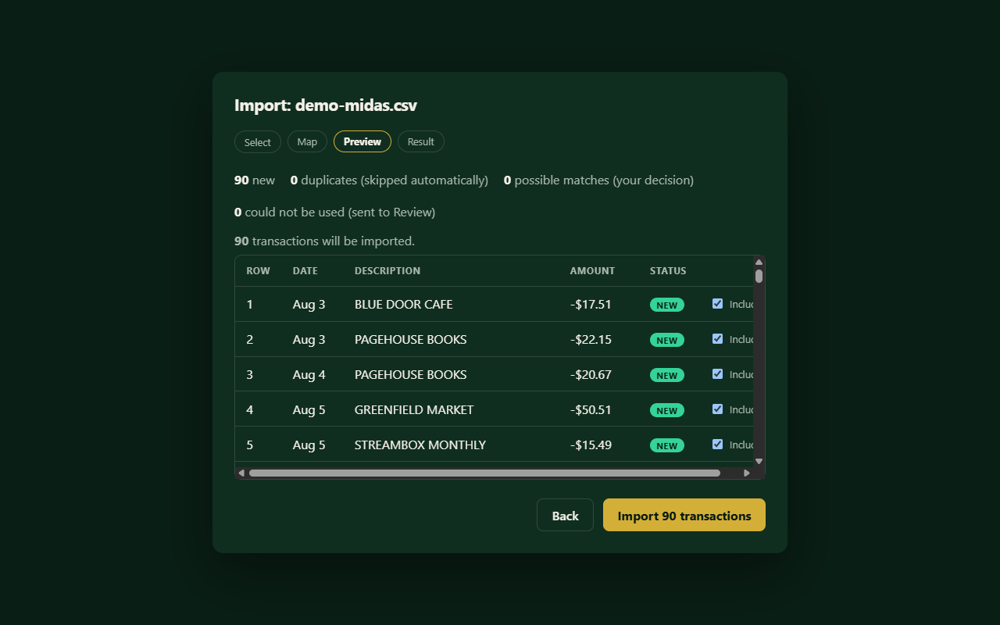

# MIDAS

A local-first personal finance app for Windows.

I built MIDAS because I wanted one place for the numbers I actually check: what is in my accounts, which bills are coming, how the month is tracking against budget, and how much is safe to spend before the next paycheck. It doesn't sync with banks, doesn't need an account, and makes no network calls. Your data is one SQLite file on your computer. It is built with Tauri 2, React, TypeScript and Rust.

## Current status

- **Version:** `1.0.0-rc.2`, a release candidate. `v0.1.0` and `v1.0.0-rc.1` are tagged. There is no final 1.0 yet.
- **Platform:** Windows only. Windows is the only platform built and tested.
- **Screenshots:** none yet. MIDAS holds real financial data, so I only want to publish captures taken from a disposable test database, and I haven't produced those.
- **License:** the source is publicly viewable, but I haven't granted an open-source license, so all rights are reserved for now.
- **Not included:** bank sync, investment/brokerage accounts, multi-device sync, scheduled backups.

## Screenshots

All of this is demo data: one fictional checking account, three months of generated transactions (imported through the real CSV wizard), a pay schedule, recurring bills confirmed from detection, and budgets from the "Suggest from spending" button.



| Budgets                                                                  | Forecast                                                                              |
| ------------------------------------------------------------------------ | ------------------------------------------------------------------------------------- |
|  |  |

| Recurring                                                                 | CSV import preview                                                                  |
| ------------------------------------------------------------------------- | ----------------------------------------------------------------------------------- |
|  |  |

## What MIDAS does

- **Accounts & transactions**: checking, savings, credit card, and cash accounts; manual entry or statement import; payees, tags, splits, merchant rules, and bulk edits.
- **Import**: CSV (flexible column mapping, saved/reusable import profiles) and OFX/QFX (structured bank statements, OFX 1.x and 2.x, checking/savings/credit card) - both feed one duplicate-protected pipeline with Import History and a safe partial Undo.
- **Reconciliation**: match transactions against a real bank/credit-card statement, clear them, and close the period once the difference is exactly zero, with running balances and full history.
- **Recurring Intelligence**: detects subscriptions, bills, and income patterns from your transaction history; tracks price changes, missed/skipped occurrences, and expected-vs-actual matching.
- **Budgets**: per-category monthly budgets with rollover, pace tracking (on track/faster/over), historical-typical suggestions, and future-month overrides.
- **Insights**: Spending, Income, Merchants, Cash Flow, and Net Worth, each with period-over-period comparison and category/merchant drilldowns into the real transactions behind a total.
- **Forecast**: a deterministic near-term cash projection (7/14/30 days) from your confirmed recurring occurrences - never a simulation, never persisted.
- **Review Center**: one place for what needs a decision (uncategorized transactions, possible duplicates, ambiguous recurring matches, import issues, broken reconciliations), a factual Data Health summary (counts, never a score), and Financial Signals - deterministic, evidence-backed observations (a category running high, a subscription price increase, income down, a low forecast balance) with a direct link back to the relevant page.
- **Safe to Spend**: the Overview home screen's headline number - what's actually free to spend before your next payday, after upcoming bills and your reserve.
- **Privacy Mode**: a one-click toggle that masks every displayed dollar amount (`$••••.••`) across the entire app - for when someone else can see your screen. Display-only; it is not encryption and does not touch your stored data.
- **First-run onboarding**: a short (5-step) guided setup for a brand-new install - welcome, a plain-language local-first explanation, your first account, your first transactions (manual or import, or skip), done. No bank credentials, no account creation, no fabricated demo data.

## Your data

- **Location**: a single SQLite file at your OS's per-app data directory - on Windows, `%APPDATA%\com.breezy.midas\midas.sqlite3` (`Connection::open` in `src-tauri/src/db.rs`, path from Tauri's `app_data_dir()`). Nothing else - no cloud copy, no second database, no cache that also holds financial data.
- **Backup**: Settings -> Rules & Data -> Backup & Restore downloads a complete, consistent snapshot of that file (SQLite's own `VACUUM INTO`, which refuses to overwrite an existing file) as a timestamped `.sqlite3` download. Keep it anywhere you like - a synced folder, a USB drive, another computer's Downloads folder. You are never required to keep MIDAS open or installed to hold onto your own data.
- **Restore**: choose a backup file on the same Settings page. MIDAS opens it as its own, separate, temporary connection first and shows you what's in it (schema version, account and transaction counts) before anything changes. Only on your explicit confirmation does it become the live database - and your previous live database is renamed aside with a timestamp (`midas.sqlite3.before-restore-<timestamp>.bak`, next to the real one), never deleted, so a restore is itself always recoverable.
- **Export**: the same Settings page exports every transaction as a plain CSV (date, account, merchant, category, type, dollar amount, notes) - readable in Excel or Google Sheets with or without MIDAS installed. This is a portability export, not a backup: it doesn't include budgets, goals, rules, or enough structure to restore from - use Backup for that.
- **Import Profiles**: Settings -> Rules & Data -> Import Profiles lists every saved CSV column mapping, with rename and archive/restore - a profile is created automatically the first time you save a mapping during import.
- **Security and privacy**: MIDAS makes zero outbound network calls of any kind (the production Content-Security-Policy has no external `connect-src`) and requests zero Tauri plugin capabilities (`src-tauri/capabilities/default.json`) - every backend operation, including import/export/backup/restore, moves data through the app's own narrow, typed commands as plain strings, never a raw filesystem or dialog API. There is no logging anywhere in the app (no `println!`, no `console.log`) that could write financial data to disk outside the database itself.
- **Privacy Mode is display-only.** It masks what's shown on screen; it is not database encryption and does not change what's stored on disk.
- **Known limitations**: backups are manual, not scheduled or automatic - MIDAS doesn't run in the background. The database file itself is not encrypted at rest (relies on your OS-level disk/account security). CSV export is one-way - it's for reading elsewhere, not for re-importing back into MIDAS. There is no multi-device sync; each installation has its own independent database unless you manually back up and restore between them. Windows is the only platform actually built and tested so far. Investment/brokerage OFX statements are explicitly rejected (not silently misread) - MIDAS does not model securities. A single import/undo of several thousand transactions at once takes a few seconds (everything completes correctly; it's simply not instant at that volume), and the Transactions table itself has no pagination or virtualization, so scrolling it gets noticeably slower once an account's history reaches that size - normal day-to-day imports and ledgers are unaffected. A historical concern about the installer hanging on a silent (`/S`) reinstall over an existing installation was re-tested for this release and did not reproduce - see the release notes for the version you're installing.

## Installing

There is no GitHub release yet; installers are built locally with `npm.cmd run package`. That produces `MIDAS_<version>_x64-setup.exe` and a matching `.sha256` file. Verify the hash before running it:

```powershell
Get-FileHash .\MIDAS_<version>_x64-setup.exe -Algorithm SHA256
```

Compare the output against the `.sha256` file. Run the installer - it installs per-user to `%LOCALAPPDATA%\MIDAS` (no administrator rights needed) and adds a Start Menu shortcut. Uninstall from _Settings → Apps_ (or the Start Menu shortcut's right-click menu) like any other Windows app - **uninstalling removes the application files only, never your data** (`%APPDATA%\com.breezy.midas\midas.sqlite3` is untouched; back it up first anyway if you're about to reformat the whole machine, not just uninstall one app).

## Project docs

[PROJECT_STATE.md](PROJECT_STATE.md) tracks phase-by-phase status, and `specs/` holds the per-phase specs and evidence.

## Development

Requirements: Node.js/npm (pinned in `.node-version`), Rust/Cargo via `rustup` (pinned in `rust-toolchain.toml`, so `cargo`/`rustc` auto-select the right version inside this repo), and the Windows MSVC build tools / Tauri 2 Windows prerequisites (WebView2).

```powershell
npm.cmd install
npm.cmd run check
cargo fmt --manifest-path src-tauri\Cargo.toml -- --check
cargo check --locked --manifest-path src-tauri\Cargo.toml
```

**App-data identity is isolated by environment** so development and automated testing can never touch real data:

| Command                  | Identifier              | App-data directory                | Purpose                                                        |
| ------------------------ | ----------------------- | --------------------------------- | -------------------------------------------------------------- |
| `npm.cmd run tauri dev`  | `com.breezy.midas.dev`  | `%APPDATA%\com.breezy.midas.dev`  | day-to-day development; data persists between sessions         |
| `npm.cmd run tauri:test` | `com.breezy.midas.test` | `%APPDATA%\com.breezy.midas.test` | disposable, used by `scripts\smoke.ps1`; wiped after every run |
| `npm.cmd run package`    | `com.breezy.midas`      | `%APPDATA%\com.breezy.midas`      | **the only command that may produce a real release installer** |

The identifier lives in `src-tauri\tauri.conf.json` (base, dev-identified) and two small overlays merged in via Tauri's `--config` flag: `src-tauri\tauri.prod.conf.json` and `src-tauri\tauri.test.conf.json`. `.forge\architecture-fitness.json` enforces that the base config never reverts to the real production identifier.

Local verification tooling (`scripts\`):

- `verify.ps1` - the normal development gate: frontend format/typecheck/test/build, Rust fmt/check/clippy/test/audit. (`validate.ps1` is the same script kept under its original name for historical phase-record continuity.)
- `release-check.ps1` - pre-tag release validation: clean tree on `main` in sync with `origin/main`, version consistency across every manifest, the full gate, and security scans (Gitleaks/Trivy).
- `smoke.ps1` - launches the disposable test identity, confirms the app responds over its real Tauri IPC bridge, then tears everything down.
- `hash-artifacts.ps1` - SHA-256 for one or more built files.

Security scans run separately from `verify.ps1` (both are also in `release-check.ps1`): `gitleaks detect`, `trivy fs`, and `npm audit`.

### CI/CD

`.gitea\workflows\validate.yml` runs the same gate as `verify.ps1` on every push to `main`. `.gitea\workflows\release.yml` triggers on a pushed `v*` tag: validates the tag against every version manifest, runs the full gate and security scans, builds with `npm run package` (the production identity), hashes the installer, writes a release manifest, and publishes a private Gitea Release with the installer/checksum/manifest attached and matching `docs\release\<version>.md` notes - no manual browser step. Both need a self-hosted Windows runner (Gitea has no hosted Windows runner, and the NSIS/WebView2 build needs a real Windows host): register one under **Settings -> Actions -> Runners** with the label `self-hosted-windows`, on a host that already has this same Development section's prerequisites plus Gitleaks and Trivy on `PATH`. No manual secret is needed - both workflows use the automatically-issued per-job token, since this repo's Actions Token Permissions are already Permissive.

## Repository map

- `constitution/`: non-negotiable MIDAS rules (adapted from App Foundry governance conventions).
- `standards/`: security, testing, accessibility, dependencies, and release requirements.
- `templates/`: reusable phase, ADR, handoff, QA, owner-gate, and release records.
- `gates/`: repeatable lifecycle checklists.
- `docs/product/`: the canonical MIDAS product and build handoffs.
- `docs/architecture/`: architecture notes as they are established.
- `docs/decisions/`: ADRs for durable technical decisions.
- `docs/release/`: filled-in release checklists, one per version.
- `specs/`: phase specs and evidence.
- `src/`, `src-tauri/`: the application.

## How it was built

The project started from a personal Tauri + React + TypeScript + Vite template (System/Light/Dark theming, a narrow production CSP, no exposed Tauri commands by default, NSIS packaging, deterministic checks) and follows a phase/gate process documented in `constitution/`, `standards/` and `gates/`. None of that is needed at runtime.
